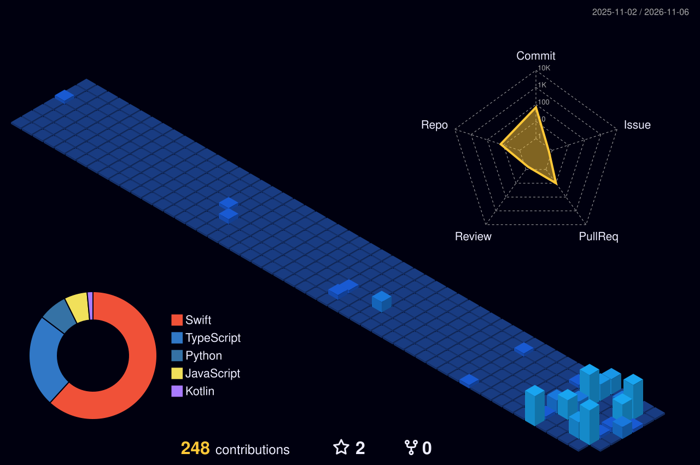

  

  

  

  

### 🧩 Projects

| Project | What it is | Stack |
|---|---|---|
| [**Shade**](https://github.com/dineshvg/Shade) | Native macOS app that pulls a translucent workspace down from the top of the screen: notes with on-device translation, a terminal for Claude Code / Copilot CLI, and quick code edits. MIT licensed. | Swift · SwiftUI · AppKit |
| [**Health Plan Agent Skill**](https://github.com/dineshvg/health-plan-app) | Claude Code skill that turns health goals into training and food plans, a private Google Sheet tracker and an installable offline-first PWA. | Agent skill · PWA · Google Sheets |
| [**E-Rezept App**](https://github.com/gematik/E-Rezept-App-Android) | Germany's official e-prescription app (2M+ users). I lead its Android architecture at gematik. | Kotlin · Compose · multi-module Gradle |
| **MCP server for app testing** | Lets any MCP-compatible AI agent drive and test mobile apps. | Kotlin Multiplatform · MCP |
| [**dineshvg.github.io**](https://dineshvg.github.io) | My portfolio. | Web |

  

  

  
  
  

<!-- SVGs are generated by build/build.py from build/config.json and refreshed daily by .github/workflows/refresh-profile.yml.
     If an edit doesn't show up, bump ?v=1 → ?v=2 on the image links (GitHub caches images aggressively). -->
